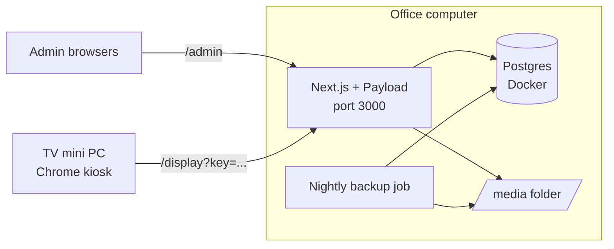

# Architecture

Phase 1 is one Next.js app with Payload CMS embedded, backed by PostgreSQL. It runs on one office computer. This file covers how it fits together; the product rules are in [spec.md](spec.md) and the fields in [data-model.md](data-model.md).

## Stack

| Layer | Choice | Notes |
| --- | --- | --- |
| Runtime | Node.js 26 LTS (`.nvmrc`) | Payload 3.94 needs `^22.23.5`, `^24.22.3` or `>=26.13.1` |
| Package manager | pnpm | Payload's preferred manager |
| App framework | Next.js, App Router, TypeScript strict | Pin to a version inside Payload 3's supported range |
| CMS | Payload CMS 3 (stable) | Embedded in the Next.js app: admin panel, Local API, auth, uploads, versions and drafts |
| Database | PostgreSQL 16 in Docker | `@payloadcms/db-postgres`; migrations committed |
| Media | Local disk (`/media`, git-ignored) | Payload upload collection with image sizes for 1080p and 4K |
| Excel | SheetJS | Parse .xlsx and .csv on the server for the import preview |
| Charts | Hand-built SVG and CSS | No chart library; matches the designs |
| Styling | ARC design system: `design/tokens.css` and `design/components.css` | Plain CSS and CSS modules; no Tailwind |
| Email | Nodemailer via SMTP (Phase 1 optional; dev: log to console) | Password reset, invites, TV offline alert |
| Tests | Vitest, Playwright | Unit and integration; TV and admin flows |
| Lint | ESLint and Prettier | `pnpm lint`, `pnpm typecheck` |

Payload v4 is in beta and needs newer Node, Next.js and TypeScript versions. Stay on Payload 3 for Phase 1.

## How it runs locally



- `docker compose up -d db` starts Postgres with a named volume.
- `pnpm build && pnpm start` runs the app in production mode on the office computer. Use `pnpm dev` while developing.
- **Admins** open `http://<computer-name>:3000/admin`.
- **The TV** opens `http://<computer-name>:3000/display?key=<display key>` in Chrome kiosk mode.
- **Backups**: a nightly `pg_dump` plus a copy of `/media`, kept 30 days (a script in `scripts/backup.sh`, run by the OS scheduler).
- **Keeping it running**: the app restarts on boot (pm2, or a Windows or macOS service) and the computer must not sleep.

Moving to a server later changes only env vars: `DATABASE_URI`, the media storage adapter (S3-compatible), `PAYLOAD_PUBLIC_SERVER_URL`, and SMTP.

## Folder layout (target)

```
.
├── CLAUDE.md
├── design/                     # ARC design system (source of truth for styles)
├── docs/
├── docker-compose.yml          # postgres
├── .env.example
├── scripts/                    # backup.sh, seed.ts
├── src/
│   ├── app/
│   │   ├── (payload)/          # Payload admin and API routes (generated)
│   │   ├── (display)/display/  # TV display route (server component + client loop)
│   │   └── api/display/        # feed and heartbeat route handlers
│   ├── collections/            # Grants, Posts, Media, Users, Funders, EngagementTypes, PostCategories, ActivityLog, ImportRuns
│   ├── globals/                # DisplaySettings, AppSettings, DisplayStatus
│   ├── admin/                  # custom admin views and components (Overview, Import wizard, Display settings)
│   ├── display/                # slide components, loop controller, offline cache
│   ├── import/                 # GrantSourceAdapter, excel adapter, column mapping, matching, review diff
│   ├── lib/                    # metrics, fiscal year, publish windows, formatting (CAD, dates)
│   ├── hooks/                  # shared Payload hooks (activity logging)
│   ├── access/                 # isAdmin, isAdminOrEditor, displayKey
│   ├── styles/                 # imports design tokens and components
│   └── payload.config.ts
└── tests/
    ├── unit/                   # vitest
    └── e2e/                    # playwright
```

## Key decisions

**D1. Payload CMS 3 embedded in Next.js.** One codebase and one process for the admin panel, the API and the TV page. Payload gives auth, roles, uploads, drafts and versions out of the box. *Rejected:* Directus (a second service to run), a custom admin (slower to build), Power BI (weak for posts and photos).

**D2. PostgreSQL in Docker, even locally.** It matches where the app will be hosted and has a supported Payload adapter. *Trade-off:* the office computer needs Docker. SQLite is the fallback if Docker isn't allowed, since Payload supports it with the same code.

**D3. Use Payload's admin, branded, with custom views where the design needs them.** The collection list and edit screens use Payload's built-in UI, themed with ARC tokens (CSS variables, logo, nav). These screens are custom admin views: Overview (dashboard), Excel import wizard, Display settings, and the TV preview. The designs are the target look; standard Payload screens only need to match them closely, not exactly.

**D4. Grants are the source of truth; metrics are computed.** `src/lib/metrics.ts` is a set of pure functions over grant records, with unit tests. The display feed calls them; nothing stores totals except the "Raised since 2016" baseline.

**D5. Source adapters.** `GrantSourceAdapter` turns any source (Excel rows now, Dynamics 365 records later) into normalised grant inputs with `source` and `externalId`. One importer applies them: match, diff, review, commit, log. The Phase 2 Dynamics 365 sync is a new adapter plus a scheduled job; nothing else changes.

**D6. The TV is a read-only client with its own feed.** `/display` renders server-side, then a client loop polls `GET /api/display/feed?key=…` every 2 minutes. The feed returns only display-safe data (hidden grants, partner names marked hidden, unpublished posts and alt-less photos are filtered out on the server). The last good feed is kept in memory and `localStorage`, so the loop survives network loss. `POST /api/display/heartbeat` records check-ins. The display key is a long random token stored hashed in `DisplaySettings`; resetting it invalidates the old link.

**D7. Activity log via hooks.** A shared `afterChange` and `afterDelete` hook on each collection writes an `activity-log` entry with a field-level diff. Sign-ins are logged from auth hooks. The log is append-only: no update or delete access for anyone.

**D8. Times and money.** All dates are stored in UTC and shown in `America/Vancouver`. The fiscal year starts on April 1 (configurable in AppSettings). Amounts are stored as integer cents in CAD and formatted for display.

## Display feed (shape)

```ts
type DisplayFeed = {
  generatedAt: string;            // ISO
  schedule: { awake: boolean; wakesAt: string; mode: 'clock' | 'dim' | 'blank' };
  slides: Array<{ id: 'glance' | 'active' | 'posts' | 'completed' | 'areas'; seconds: number; enabled: boolean }>;
  glance: { activeCount: number; activeFundingCents: number; completedThisFY: number; studentsActive: number;
            fundingByFunder: Array<{ funder: string; cents: number }>; raisedSince2016Cents: number; endingIn90Days: number };
  activeGrants: DisplayGrant[];   // paged 6 per slide by the client
  posts: DisplayPost[];           // published, in window, pinned first
  completed: { countThisFY: number; studentsThisFY: number; partnersThisFY: number; recent: DisplayGrant[] }; // recent: last 3
  areas: Array<{ area: Area; cents: number; share: number; activeCount: number; largestFunder: string | null }>;
};
```

## Security (local)

- The admin panel is only reachable on the office network. Use strong passwords with lockout (5 attempts, 15 minutes).
- The display route needs the key; without it, it returns 404.
- Secrets (`PAYLOAD_SECRET`, `DATABASE_URI`, SMTP) live in `.env` only.
- When hosted: HTTPS, and Langara's privacy review (FIPPA) before real data goes in.
