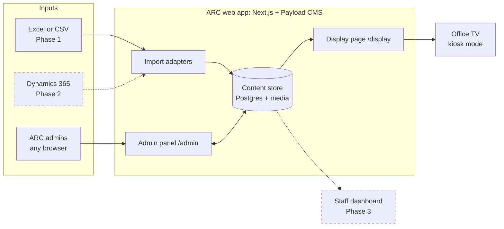

# ARC Dashboard & CMS — Product Spec

Version 1 · November 2026 · Source: [the spec doc](https://claude.ai/artifact/F9jNCm48CuLpGUh8DhK9cU) (this file is the repo copy; keep both in step)

## Overview

We will build a web app with two parts. One is a TV display in the ARC office that shows grant metrics, active and completed projects, and news posts. The other is an admin CMS where ARC staff keep that content current without a developer.

**Background.** The [Applied Research Centre](https://langara.ca/applied-research-centre) (ARC) at Langara College runs applied research with businesses, not-for-profits, municipalities and First Nations. It works in three areas: Natural Products Innovation, Data Analytics and Bioinformatics, and Social Innovation. Its services include capstone projects, limited engagements, contract research and federally funded partnerships. ARC reports $12.5M in funding since 2016 from BCKDF, CFI, DFO, ESDC, Mitacs, NSERC and SSHRC.

**Goals**

- Show ARC's activity and impact on an office TV, refreshed automatically, with no one touching it.
- Let admins add and update grants, posts and photos in minutes, with no code.
- Import grant data from Excel now, and switch to Dynamics 365 later without a rebuild.
- Leave room for an interactive staff dashboard and other features later.

**Non-goals (Phase 1)**

- Public, external-facing website pages.
- Interactive, per-user dashboards for staff on their own devices.
- Live Dynamics 365 integration (planned for Phase 2).
- Grant application workflows, budgeting or financial reconciliation.

## Users and roles

Phase 1 has two signed-in roles (Admin and Editor) plus the TV audience, who only watch.

| Role | Who | Can do | Signs in? |
| --- | --- | --- | --- |
| Admin | ARC staff who manage content (2–5 people) | Add, edit and archive grants and posts; upload photos; import Excel; change display settings; manage users and settings; read the activity log | Yes: email and password in Phase 1, Microsoft sign-in in Phase 2 |
| Editor | Staff who write posts only | Add, edit and publish posts and photos; no grant data, imports, users or settings | Yes |
| Display viewer | Anyone in the office who sees the TV | Watch the rotating display | No: the TV opens a private display link |
| Staff viewer (Phase 3) | ARC and Langara staff | Browse an interactive dashboard on their own device | Yes, Microsoft sign-in |

## Data model

Grants are the source of truth: admins maintain grant records, and every metric on the TV is calculated from them. No one types in a total by hand, so the numbers always agree with each other. Field-level detail for the code is in [data-model.md](data-model.md).

**Grant**

| Field | Type | Notes |
| --- | --- | --- |
| Title | Text | Required |
| Short description | Text, max 200 characters | Shown on the TV |
| Funder | Pick list | NSERC, SSHRC, Mitacs, CFI, BCKDF, DFO, ESDC, Private, Other; managed in Settings |
| Program | Text | e.g. NSERC ARD, Mitacs Accelerate |
| Amount (CAD) | Number | Total awarded |
| Area | Pick list | Natural Products Innovation, Data Analytics and Bioinformatics, Social Innovation |
| Engagement type | Pick list | Federally funded partnership, Contract research, Limited engagement, Capstone; managed in Settings |
| Faculty lead | Text | Phase 2: link to a person record |
| Partner organization | Text | "Hide partner name on the TV" option per grant |
| Start date / End date | Date | End date must be after start date |
| Status | Pick list | Pending, Active, Completed, Archived |
| Auto-complete | Yes/No | Marks the grant Completed after its end date; default from Settings |
| Students involved | Number | Optional; feeds the TV's student counts |
| Outcome highlight | Text, max 120 characters | One line shown on the Recently completed slide |
| Cover photo | Media library item | Optional; the TV shows a brand colour block when empty |
| Show on display | Yes/No | Hides sensitive grants from the TV |
| Source and external ID | System | "Excel" or "Dynamics 365" plus the source row's ID, used to match records on re-import |
| Last edited | System | Who and when; full history in the activity log |

**Post**: title, body (rich text), one or more photos from the media library, category (News, Event, Milestone, Spotlight; managed in Settings), optional linked grant, publish date, expiry date, pinned yes/no, and status. Status is Draft, Scheduled (publish date in the future), Published, or Expired (past its expiry date). Expired posts stay in the list for reuse but never show on the TV.

**Media**: images uploaded once to a library and reused across posts and grants. Each has alt text (required before it can show on the TV), an optional photo credit, and a "used in" list. Uploads are resized automatically for 1080p and 4K screens. A photo in use can't be deleted.

**User**: name, email, role (Admin or Editor), status (Invited, Active), last sign-in.

**Activity entry**: when, who (a user or System), action, item, and details of what changed. Kept for 2 years.

**Calculated metrics** (all from grants with Status = Active or Completed):

- Active grants: count and total value
- Completed grants this fiscal year (Langara's year runs April to March)
- Funding by funder and by area
- Grants ending in the next 90 days
- Total funding since 2016, starting from a baseline admins can set (the reported $12.5M) until all historical grants are entered

## TV display

The TV shows a loop of five full-screen slides, about 2 minutes 20 seconds in total, plus an after-hours screen. It needs no mouse, keyboard or login once it is set up. Every slide is drawn in the [screen designs](https://claude.ai/artifact/VYvfbYRXrCikR8EFNApyFB) and follows the [ARC Design System](../design/README.md): a bright white screen with Langara orange, amber, gold and sand blocks, black text on colour, slab-serif titles that end in a period, and the full-colour ARC logo.

**Slide catalog (Phase 1)**

| Slide | Shows | Default time |
| --- | --- | --- |
| 1 · At a glance | Four key numbers on orange, amber, gold and sand tiles: active grants, active funding, completed this fiscal year, students involved. Active funding by funder as bars. "Raised since 2016" in large orange, and a count of grants ending in the next 90 days | 20 s |
| 2 · Active grants | Six grant cards per page (photo, area, title, funder, end date); pages through all active grants, 20 s per page | 20 s per page |
| 3 · Featured post | One published post per slide: large photo, category tag, headline, first 200 characters, event details | 15 s per post |
| 4 · Recently completed | Count of grants completed this fiscal year with students and partners involved, plus the three most recent completions with their outcome highlight | 15 s |
| 5 · Funding by area | Total active funding, a split bar across the three research areas, and one card per area: amount, share, active grants, largest funder | 15 s |
| After hours | Outside office hours: a dim, dark clock screen with the date and the time the display wakes | Until wake time |

Every slide shares one frame: a thin orange-to-sand colour stripe along the top, the ARC logo with the slide title and a five-dot pager, a progress bar for the current slide, and a footer with the date and time and the name of the next slide. Slides with no data are skipped automatically, for example Featured post when nothing is published.

**Display requirements**

- Designed for 1920×1080 landscape; scales cleanly to 4K. 96 px side margins keep content inside the TV's safe area.
- Readable from 3–4 m: nothing smaller than 22 px, body text 30 px, key numbers 96–160 px.
- Bright theme during office hours; text on orange, amber, gold and sand is always black for contrast. Check glare on the real TV; a sand background is the fallback.
- Checks for new content every 2 minutes and updates between slides, without a visible reload.
- Keeps showing the last good content if the network drops, with a small "offline" marker.
- Shifts content a few pixels every hour to avoid screen burn-in.
- After hours and on B.C. statutory holidays, shows the dark clock screen, or dims or blanks, as set in Display settings.
- Opened by a private link with a long random key; admins can reset the key at any time.
- Reports a check-in every 2 minutes; admins get an email if the TV misses 3 in a row.

**Hardware**: any device that runs a current Chrome in full-screen kiosk mode. Options are a small mini PC (most reliable), a Chromecast with Google TV, or the TV's built-in browser if it supports kiosk mode.

## Admin CMS

The admin panel has 13 screens in four groups: Overview and TV preview, Content, Data, and Admin. Staff open it in any web browser; every saved change shows on the TV within 2 minutes. Designs: https://claude.ai/artifact/VYvfbYRXrCikR8EFNApyFB

| Group | Screen | Purpose | Who | Phase |
| --- | --- | --- | --- | --- |
| — | Sign in | Get into the admin panel | Everyone | 1 (Microsoft sign-in: 2) |
| — | Overview | What's on the TV, what needs attention, recent activity | Admin, Editor | 1 |
| Content | Grants | Find and manage grants | Admin | 1 |
| Content | Edit grant | Add or change one grant | Admin | 1 |
| Content | Posts | Find and manage posts | Admin, Editor | 1 |
| Content | Edit post | Write, schedule and publish a post | Admin, Editor | 1 |
| Content | Media library | Upload and manage photos | Admin, Editor | 1 |
| Data | Excel import | Upload, match columns, review, import | Admin | 1 |
| Data | Integrations | Dynamics 365 sync and sign-in method | Admin | 2 |
| Admin | Display settings | Slides, timing, schedule, display link, TV status | Admin | 1 |
| Admin | Users and roles | Invite people and set their role | Admin | 1 |
| Admin | Activity log | Every change, import and sign-in | Admin | 1 |
| Admin | Settings | Pick lists, TV number rules, backups | Admin | 1 |

### Sign in

- Email and password, "Forgot password?" by email link, and "Keep me signed in on this device".
- After 5 failed attempts the account locks for 15 minutes; every sign-in and failure is logged.
- Phase 2 adds "Sign in with your Langara Microsoft account" (Entra ID).

### Overview

- Greets the signed-in person and shows a thumbnail of the TV with its status (online, last check-in, resolution) and the current slide loop.
- Four numbers: active grants and funding, posts on the TV, completed this year, and items needing attention.
- **Needs attention** list with a direct fix link for each: grants ending in 90 days, active grants with no photo, posts expiring tomorrow, rows skipped by the last import, photos with no alt text.
- **Recent activity**: the last 5 entries from the activity log.
- Quick actions: Add grant, New post.

### Grants

- Summary counts: Active, Completed, Pending, Hidden from TV.
- Search by title, faculty lead or partner; filter by status, funder, area and year; sort by end date or amount.
- Table: title and engagement type, funder, area, amount, end date, status badge, shown or hidden on TV, Edit.
- Buttons: Import from Excel, Add grant.

### Edit grant

- Every grant field from the data model, with inline validation (for example, end date after start date).
- Status as one-click buttons: Pending, Active, Completed, Archived.
- Cover photo picked from or uploaded to the media library.
- "Show on display" switch, "Hide partner name on the TV", and a live preview of the grant's TV card.
- Shows the record's source (Excel row or Dynamics 365) and who last edited it. Archive instead of delete.

### Posts

- Tabs with counts: All, Published, Scheduled, Drafts, Expired; search by title.
- Table: thumbnail, title, category, status, on TV from, until, pinned, Edit.
- Expired posts stay listed for reuse but never show on the TV.

### Edit post

- Title, category, rich-text body (bold, italic, heading, list, link) with a note that the TV shows the first 200 characters.
- Photos from the media library, with alt text and crop.
- Publishing panel: publish date, removal date, optional linked grant, "Pin to every loop".
- TV preview thumbnail and "Preview on TV" for the full-size slide. Save as draft or Publish.

### Media library

- Grid of photos with filters: All, In use, Not used, Missing alt text; search by file name or alt text.
- Details panel: preview, file size and dimensions, uploader, alt text (required before a photo can show on the TV), credit, and where it's used.
- Replace file keeps every place the photo is used. A photo in use can't be deleted.

### Excel import

1. **Upload**: drop an .xlsx or .csv, or download the import template.
2. **Match columns**: pick the sheet; each spreadsheet column gets a grant field or "Don't import", with an example value and a check badge. Matches are remembered. Required: Title, Funder, Status, Grant ID.
3. **Review changes**: counts of new, updated and error rows; a row-by-row table of what will change; plain-language errors with suggested fixes; option to skip error rows.
4. **Done**: summary, link to the grants list, entry in the activity log. Nothing changes until the admin confirms.

### Integrations (Phase 2)

- Dynamics 365 card: connection status, set-up steps, environment URL, sync schedule (hourly by default), Test connection, Turn on sync. Synced fields become read-only in the CMS.
- Excel import card: still available for grants that aren't in Dynamics 365.
- Sign-in card: email and password now, Langara Microsoft accounts in Phase 2.

### Display settings

- Slides in the loop: drag to reorder, show or hide each slide, seconds on screen, and the total loop length.
- Schedule: days, wake and sleep times, what happens after hours (clock screen, dimmed loop, or blank), and statutory holidays.
- Display status: online or offline, last check-in, screen size, last content update; email alert after 3 missed check-ins.
- Private display link: copy or reset.
- Screen care: hourly pixel shift, offline marker.

### Users and roles

- Role cards explaining Admin and Editor.
- Table: name, email, role (changeable), last sign-in, status (Invited or Active), Remove or Resend invite.
- At least one Admin must always exist. In Phase 2, access follows the person's Langara Microsoft account.

### Activity log

- Filters: who, what (grants, posts, media, imports and syncs, settings and users, sign-ins), and date range.
- Table: when, who, action badge, item, details of the change (for example "Status Active → Completed").
- Export to CSV. Entries are kept for 2 years and can't be edited.

### Settings

- Pick lists: funders, engagement types and post categories (add or rename; items in use can't be deleted). Research areas with their design-system colours.
- Numbers on the TV: fiscal year start (April 1), the "Raised since 2016" baseline and whether to use it, and the default for auto-completing grants.
- Data and backups: last backup, retention, export all grants to .xlsx, download the import template.

## Data sources

Every data source feeds the same grant records through a small adapter, so moving from Excel to Dynamics 365 changes one adapter and nothing on the TV or in the CMS.

| Phase | Source | How it arrives | Who owns the data |
| --- | --- | --- | --- |
| 1 | Excel (.xlsx) or CSV | Admin uploads in the CMS; preview, then confirm | The CMS; edits made in the CMS are kept |
| 2 | Dynamics 365 (Dataverse) | Scheduled sync, e.g. every hour, read-only, through the Dataverse Web API with an app account set up by Langara IT | Dynamics 365 for synced fields; the CMS for photos, display text and "show on display" |
| 3 (optional) | Other systems (finance, HR) | Same adapter pattern | Agreed per source |

**Rules that keep the switch clean**

- Each grant stores its source and the source's own ID, so a re-import or sync updates the right record.
- When Dynamics 365 is connected, fields it provides become read-only in the CMS so the two never disagree.
- Display-only fields (photo, short description, show on display) always stay editable in the CMS.
- Each import or sync writes a log entry: time, rows added, updated, skipped and failed.

## Non-functional requirements

| Area | Requirement |
| --- | --- |
| Security | Admin panel behind login (HTTPS once hosted); passwords hashed; lockout after repeated failed logins. Display link is read-only and shows only items marked "show on display". |
| Privacy | Langara is a BC public body under FIPPA. Confirm with Langara's privacy office whether a privacy impact assessment is needed and where data may be hosted. Show no personal information on the TV beyond names staff agree to show. |
| Confidentiality | Admins can hide amounts, partner names or whole grants from the TV, since anyone walking by can see it. |
| Reliability | TV runs unattended for weeks; recovers on its own after a power cut or network loss. |
| Performance | Each slide renders in under 1 second on a low-cost device; admin pages load in under 2 seconds. |
| Backups | Nightly database and media backups, kept 30 days; a restore tested before launch. |
| Accessibility | Admin panel meets WCAG 2.1 AA. TV meets AA contrast; photos need alt text. |
| Maintainability | Standard, well-documented stack; one-command local setup; content model changes without a rewrite. |

## Architecture and tech stack

One small web app: Payload CMS 3 inside Next.js, with PostgreSQL. Phase 1 runs locally on one office computer. Full detail in [architecture.md](architecture.md).

Admins and imports write to one content store. The display page and, later, the staff dashboard only read from it, so a bad import can never break the TV mid-loop.

**Alternatives considered.** Power BI handles Excel and Dynamics 365 well, but is weak for posts and photos and awkward on a TV. Digital signage tools handle posts, but cannot calculate grant metrics or sync with Dynamics 365. Directus is a good substitute for Payload if IT prefers a separate CMS service.

## Roadmap

Phase 1 delivers a working TV display and CMS on Excel data. Each later phase starts only when its gate is met.

| Phase | Scope | Gate to start the next phase |
| --- | --- | --- |
| 1 · TV display + CMS | Grant and post management, media library, Excel import with review, the TV loop with 5 slides and after-hours screen, display settings, users and roles, activity log, settings, backups | ARC signs off Phase 1; Langara IT grants Dynamics 365 access |
| 2 · Connect Dynamics 365 | Hourly Dynamics 365 sync, Microsoft sign-in, synced fields read-only, custom slide layouts | Sync runs without errors; staff dashboard needs agreed |
| 3 · Staff dashboard | Interactive dashboard, filters and drill-down, reports and exports, more data sources | — |

Dates are set once the open questions below are answered, especially hosting and the Excel sample.

**Phase 1 is done when**

- [ ] An admin adds a grant with a photo and sees it on the TV within 2 minutes.
- [ ] Marking a grant Completed moves it from Active grants to Recently completed, and the numbers update.
- [ ] Importing ARC's Excel sheet twice creates no duplicates, and the review step flags bad rows.
- [ ] A scheduled post appears on its publish date and drops off the TV after its removal date.
- [ ] Grants marked hidden, and photos without alt text, never appear on the TV.
- [ ] An Editor can publish posts but can't open grants, imports, users or settings.
- [ ] Every change, import and sign-in appears in the activity log with who and when.
- [ ] Turning a slide off or changing its time in Display settings takes effect on the next loop.
- [ ] The TV switches to the after-hours screen at the set time and wakes in the morning.
- [ ] The TV runs 7 days unattended and recovers on its own after a network outage; admins get an alert after 3 missed check-ins.
- [ ] TV text is readable from 4 m, and the admin panel passes a WCAG 2.1 AA check.
- [ ] A backup is restored successfully to a test environment.

## Open questions

- [ ] Can we get a sample of the current Excel sheet (dummy values are fine) to fix the import mapping?
- [ ] Which grant fields are OK to show on a TV anyone can walk past: amounts, partner names, faculty names?
- [ ] Where may this be hosted? Ask Langara IT about approved cloud providers, Canadian data residency and a privacy impact assessment.
- [ ] Who are the 2–5 admins, and who needs the post-only Editor role?
- [ ] TV details: screen size and resolution, location, glare from nearby windows, and whether a mini PC can be mounted behind it.
- [ ] Office hours for the display: are 8:00 AM to 6:00 PM, Monday to Friday, right?
- [ ] Can Langara IT provide web licences for the brand fonts, Adelle and TheSans? Until then the system uses Roboto Slab and Roboto, the guide's approved alternates.
- [ ] Does Strategic Communications and Marketing approve the derived ARC logo files (white-text version and mark only)? The TV uses the original full-colour logo.
- [ ] Should "total funding since 2016" use the $12.5M baseline, or only grants entered in the system?
- [ ] Dynamics 365: which entity holds grants today, and who in IT can create an app account for read access?
- [ ] Local hosting: which office computer runs the app, and will Langara IT allow it to serve pages on the office network?

Answered: the display follows the Langara Brand Guidelines 2025 through the ARC Design System.
